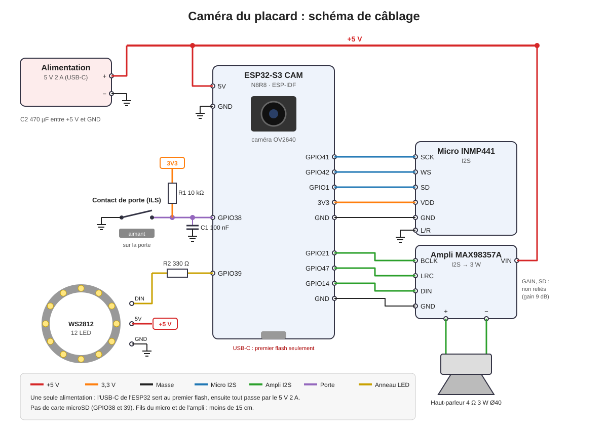

# Caméra du placard

Un ESP32-S3 avec caméra, micro et haut-parleur est placé dans le placard. Quand la porte
s'ouvre entre 7 h et 9 h, il reconnaît la personne :

| Qui | Ce que dit le placard |
|---|---|
| Alexis | La météo du jour (ciel, températures, pluie, conseil parapluie ou manteau) |
| Marie | Un compliment tiré d'une liste de 32 phrases, ou inventé par l'IA si elle est réglée |
| Visage inconnu | « Tu n'as rien à faire dans ce placard ! » |
| Aucun visage | Rien |

## Architecture

```
Porte ─ contact ILS ─► ESP32-S3 (ESPHome) ──Wi-Fi──► Home Assistant ──► CompreFace (local)
                        │ allume l'anneau LED          │ photo, reconnaissance
                        │ caméra, micro, ampli ◄────────┘ météo ou phrase, synthèse vocale
```

- **L'ESP32 détecte et parle, Home Assistant décide.** ESPHome ne sait pas reconnaître un
  visage. L'ESP32 signale l'ouverture de la porte et allume l'anneau LED pour éclairer le
  visage. Home Assistant prend alors la photo et la confie à CompreFace.
- **CompreFace** reconnaît les visages en local, sans cloud. Il tourne en module complémentaire
  Home Assistant ou en conteneur Docker. Il demande un processeur avec AVX et environ 2 Go de
  mémoire : sur un Raspberry Pi, le faire tourner sur un autre ordinateur.
- **Micro** : il n'écoute le mot « Okay Nabu » que porte ouverte. On peut ainsi demander
  « quel temps fera-t-il demain ? » à l'assistant vocal de Home Assistant.

## Matériel

| Réf. | Élément | Remarque |
|---|---|---|
| — | ESP32-S3 CAM N8R8 ou N16R8 (Freenove ESP32-S3 WROOM CAM ou clone), OV2640 | Brochage caméra ESP32-S3-EYE |
| J5 | Micro I2S INMP441 | 3,3 V |
| J6 | Ampli I2S MAX98357A | 5 V, 3 W |
| — | Haut-parleur 4 Ω 3 W, Ø 40 mm | Sur le bornier de l'ampli |
| J2 | Contact magnétique de porte (ILS, type MC-38) | Fermé quand l'aimant est en face |
| J3 | Anneau WS2812B 12 LED, Ø 37 mm | Éclaire le visage |
| J4 | Alimentation 5 V 2 A | Une prise USB-C et un câble suffisent |
| R1, R2 | 10 kΩ, 330 Ω | Rappel de la porte, protection de la ligne LED |
| C1, C4 | 100 nF | Antirebond de la porte, découplage du micro |
| C2, C3 | 470 µF 10 V, 10 µF | Réserve pour l'ampli et les LED |
| — | 4 vis M3 × 10, 4 vis M2,5 × 6 | Boîtier et PCB |

## Câblage



| ESP32-S3 | Vers | Rôle |
|---|---|---|
| 5V, GND | Alimentation 5 V, ampli VIN, anneau 5V | Puissance |
| 3V3 | INMP441 VDD, R1 | |
| GPIO41, GPIO42, GPIO1 | INMP441 SCK, WS, SD | Micro (L/R à la masse) |
| GPIO21, GPIO47, GPIO14 | MAX98357A BCLK, LRC, DIN | Ampli (GAIN et SD non reliés) |
| GPIO38 | Contact de porte, autre fil à la masse | Pull-up 10 kΩ, 100 nF |
| GPIO39 | Anneau WS2812 DIN, via 330 Ω | |

- Les broches GPIO4 à 18 servent à la caméra, 19 et 20 à l'USB, 35 à 37 à la PSRAM octale.
- GPIO38 et GPIO39 sont aussi celles du lecteur microSD de la carte Freenove : ne pas insérer de carte.
- **Une seule source de 5 V.** Brancher l'USB-C de l'ESP32 pour le premier flash seulement,
  alimentation 5 V débranchée. Les mises à jour suivantes passent par le Wi-Fi.

## Fichiers

| Fichier | Contenu |
|---|---|
| [esphome/camera-placard.yaml](esphome/camera-placard.yaml) | Configuration ESPHome |
| [homeassistant/camera_placard.yaml](homeassistant/camera_placard.yaml) | Paquet Home Assistant : reconnaissance, météo, phrases, automatisation |
| [hardware/cablage.svg](hardware/cablage.svg) | Schéma de câblage |
| [hardware/fusion/a_camera_placard/](hardware/fusion/a_camera_placard/) | Script Fusion 360 du boîtier : façade et fond, export STL et STEP |
| [hardware/kicad/](hardware/kicad/) | Projet KiCad 8 du PCB porteur |

## Mise en service

1. **ESPHome** : dans ESPHome Builder, créer l'appareil `camera-placard`, coller
   `camera-placard.yaml`, ajouter `placard_api_key` et `placard_ota_password` aux secrets,
   puis *Installer → Branché sur cet ordinateur* pour le premier flash. Ajuster
   `vertical_flip` et `horizontal_mirror` selon l'image de l'entité caméra.
2. **CompreFace** : installer le module complémentaire (dépôt `jakowenko/double-take-hassio-addons`)
   ou le conteneur Docker. Dans son interface (port 8000), créer une application puis un service
   **Recognition**, et copier sa clé dans `compreface_cle_api` du `secrets.yaml` de Home Assistant.
3. **Paquet Home Assistant** : activer les paquets
   (`homeassistant: packages: !include_dir_named packages`), copier `camera_placard.yaml` dans
   `/config/packages/`, créer le dossier `/media/placard`. Adapter le script
   `placard_reglages` : entité météo, moteur TTS, adresse de CompreFace, entité IA facultative.
   Redémarrer Home Assistant.
4. **Apprendre les visages** : porte ouverte, lancer 5 à 10 fois
   *Placard : apprendre un visage* pour Alexis, puis pour Marie, en bougeant un peu la tête.
   Les photos prises par la caméra du placard, avec sa lumière, reconnaissent mieux que des
   photos de téléphone.
5. **Tester** : lancer *Placard : qui est là ?* depuis Outils de développement → Actions,
   puis *Placard : météo du jour* et *Placard : compliment pour Marie*. Ajuster `seuil`
   (0,92 par défaut) si Marie est prise pour une inconnue ou l'inverse.

## Les phrases pour Marie

Les 32 phrases sont dans le script `placard_compliment` du paquet : « Tu es ravissante
aujourd'hui », « Tu sais qu'Alexis t'aime fort ? », « J'aimerais être ton amoureux, mais la
place est déjà prise par Alexis », « Mais quelle bombe ! »… En ajouter ou en retirer
directement dans la liste.

Pour des phrases toujours nouvelles, renseigner `ia` dans `placard_reglages` avec une entité
*Tâche IA* (Home Assistant 2025.8 ou plus récent, par exemple via OpenAI, Google ou Ollama).
Le script lui donne une phrase de la liste comme exemple de ton, et reprend la liste si l'IA
ne répond pas.

## Boîtier imprimé en 3D

Le boîtier se construit dans Fusion 360 avec le script
[a_camera_placard](hardware/fusion/a_camera_placard/a_camera_placard.py) :
*Utilitaires → Scripts et compléments* (Maj+S), bouton « + », *Script ou complément depuis
l'appareil*, choisir le dossier `a_camera_placard`, puis *Exécuter*. Le script crée un nouveau
document avec les composants « Façade » et « Fond », chacun fait d'esquisses et d'extrusions
modifiables dans l'historique. Il exporte aussi les STL et STEP dans `a_camera_placard/export/`.

Deux pièces sans support, intérieur 92 × 104 × 34 mm :

- **Façade**, en PLA blanc, imprimée face avant sur le plateau : trou d'objectif, logement
  de l'anneau LED derrière 0,8 mm de plastique qui diffuse la lumière, grille du haut-parleur,
  évent du micro, deux plots pour la carte ESP32.
- **Fond** : entretoises du PCB porteur, deux trous en serrure pour l'accrocher dans le
  placard, passe-fils pour l'alimentation et le contact de porte, aérations.

Les cotes de la carte ESP32 (`ESP`, `ESP_CAMERA_BORD`, `ESP_HAUTEUR`) et `CAMERA_POS`, en tête
du script, viennent des fiches techniques : les mesurer sur la carte avant d'imprimer. Placer le boîtier
à hauteur de visage, objectif tourné vers l'ouverture de la porte.

## PCB porteur (KiCad)

Le PCB de 60 × 40 mm, double face, ne porte que des composants traversants et des modules sur
connecteurs. Il relie l'ESP32 par un harnais de 12 fils (J1). Ainsi, il ne dépend pas du
brochage de la carte caméra, et l'objectif peut rester collé à la façade.

État : schéma complet, empreintes placées sur le PCB avec leurs réseaux, plans de masse sur
les deux faces. **Les pistes restent à router.**

1. Ouvrir `camera-placard.kicad_pro` dans KiCad 8 ou plus récent.
2. Schéma : lancer l'ERC, puis *Outils → Mettre à jour le PCB depuis le schéma* pour reprendre
   les empreintes des bibliothèques officielles.
3. PCB : router (manuellement ou avec Freerouting), pistes de 0,8 mm pour +5V et GND,
   touche **B** pour remplir les plans de masse, puis lancer le DRC.
4. *Fichier → Fabrication → Gerbers* et fichier de perçage, à envoyer à JLCPCB ou PCBWay.

Le PCB est facultatif : tout peut se câbler en fils Dupont sur une plaque à pastilles.

## Vie privée

- Les photos restent chez vous : `/media/placard/derniere.jpg`, écrasée à chaque ouverture.
  Ce dossier exige une connexion à Home Assistant, contrairement à `/config/www`.
- La reconnaissance se fait en local dans CompreFace.
- Le micro n'écoute le mot d'activation que porte ouverte.

## Avancement

- [x] Scénario, matériel et câblage
- [x] Configuration ESPHome (`esphome config` valide avec ESPHome 2026.10.2, pas encore compilée)
- [x] Paquet Home Assistant (YAML et modèles vérifiés hors de Home Assistant)
- [x] Script Fusion 360 du boîtier (vérifié hors de Fusion seulement, pas encore lancé ni imprimé)
- [x] Projet KiCad : schéma, placement, réseaux (pas encore ouvert dans KiCad)
- [ ] Commander le micro, l'ampli, le haut-parleur, l'anneau LED et le contact de porte
- [ ] Flasher l'ESP32, régler l'image de la caméra
- [ ] Installer CompreFace, apprendre les visages, régler le seuil
- [ ] Mesurer la carte, ajuster et imprimer le boîtier
- [ ] Router et commander le PCB (ou câbler sur plaque à pastilles)
